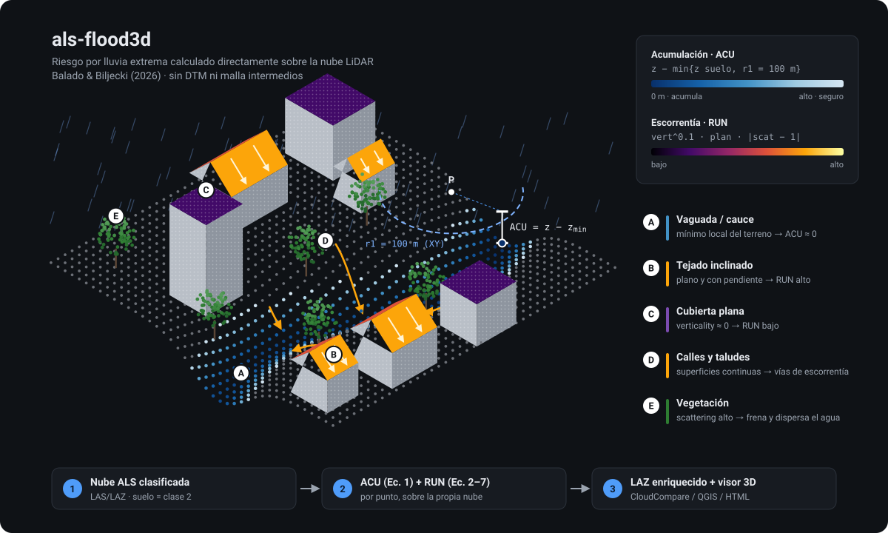
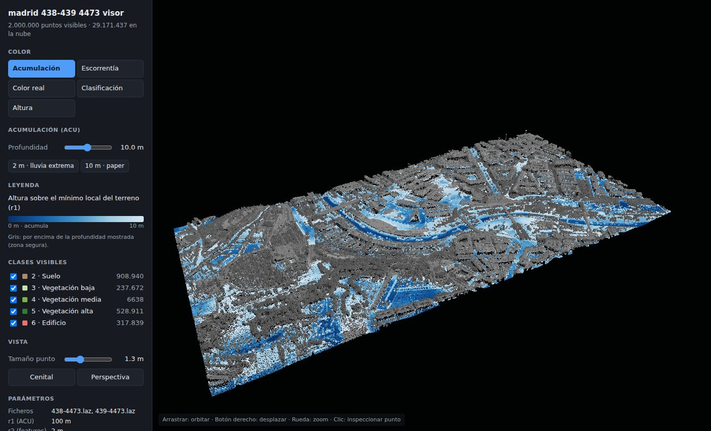
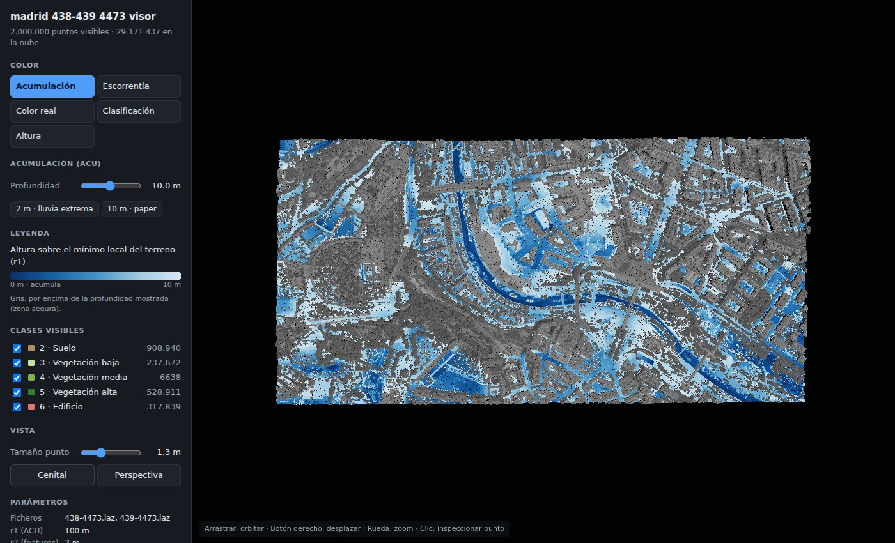
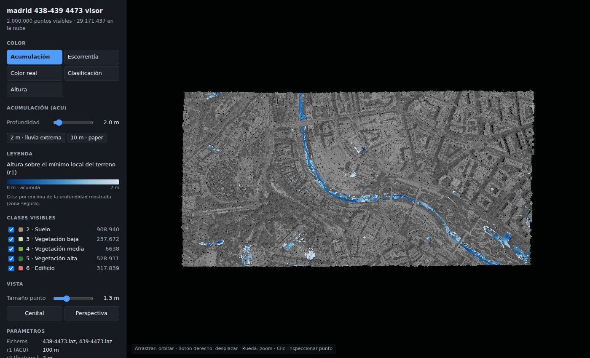
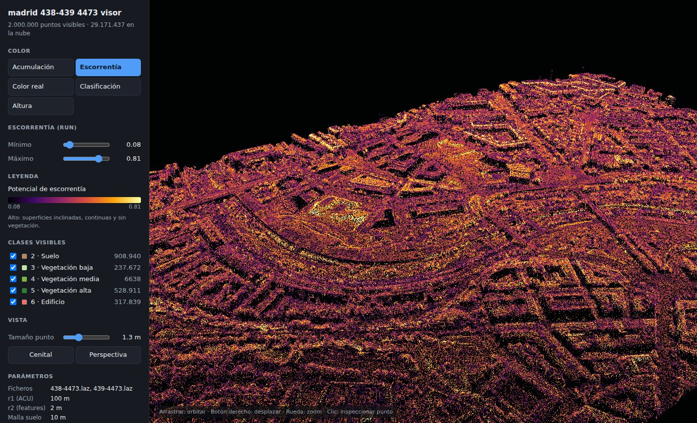
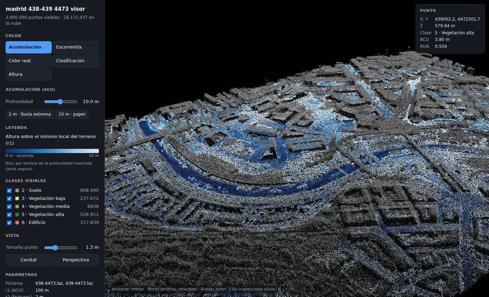
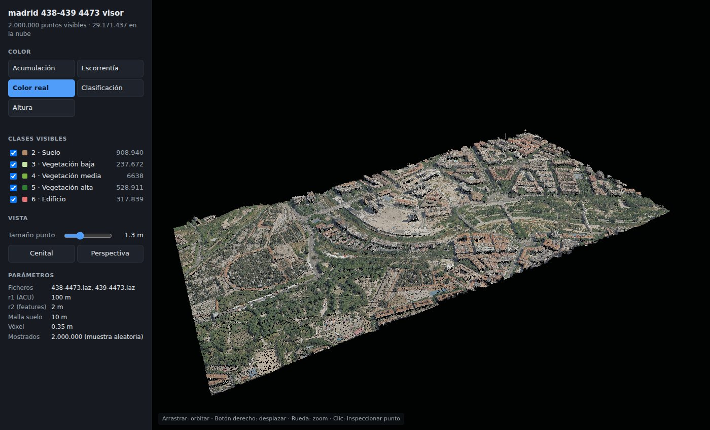
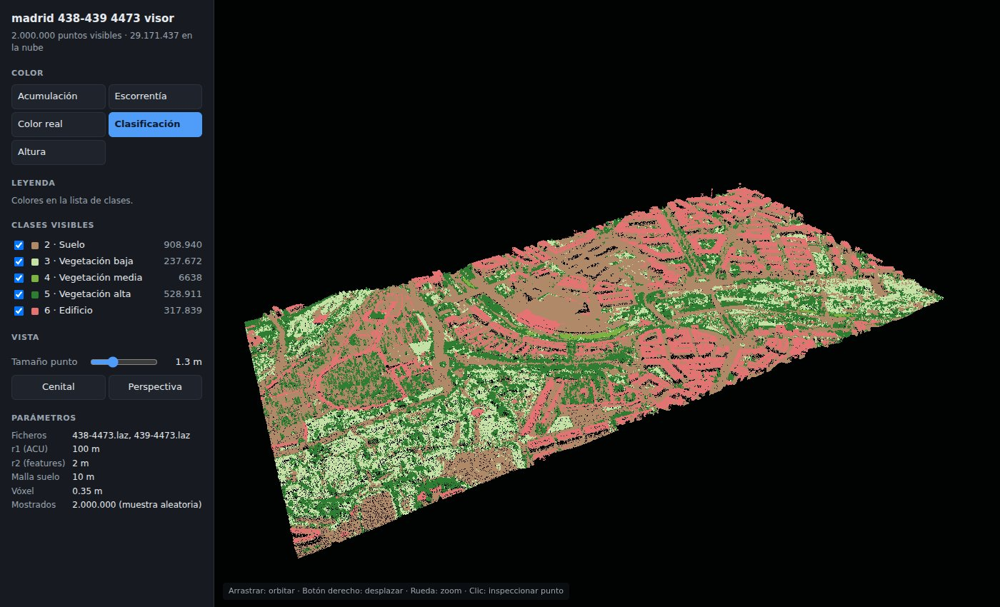

# als-flood3d

Implementación en Python del método de **Balado & Biljecki (2026)**, *Direct 3D extreme rainfall risk mapping from urban aerial LiDAR point clouds*, ISPRS Annals XII-4/W1-2026, 33–40 ([doi](https://doi.org/10.5194/isprs-annals-XII-4-W1-2026-33-2026)). El código MATLAB de los autores está en [jbalado/ALS_Flood3D](https://github.com/jbalado/ALS_Flood3D).



Enriquece cada punto de una nube LiDAR aérea (ALS) clasificada con dos indicadores de riesgo por lluvia extrema. No hace falta reconstruir antes ninguna superficie (ni DTM ni malla). Incluye un visor 3D en HTML para explorar el resultado.

| Campo | Ecuación | Significado |
|---|---|---|
| `ACU` | (1) `z − min{z_i suelo : dist_XY ≤ r1}` | Altura sobre el suelo más bajo en un radio de 100 m. **Bajo ⇒ zona de acumulación de agua.** |
| `verticality` | (2) `1 − \|N_z\|` | Pendiente local |
| `planarity` | (5) `(λ2 − λ1) / λ3` | Superficie continua (λ1 ≤ λ2 ≤ λ3) |
| `scattering` | (6) `λ1 / λ3` | Rugosidad / vegetación |
| `RUN` | (7) `verticality^0.1 · planarity · \|scattering − 1\|` | Potencial de escorrentía. **Alto ⇒ vía de escorrentía.** |

## Instalación

```bash
python -m venv .venv && source .venv/bin/activate
pip install -e ".[dev]"
```

Dependencias: `numpy`, `scipy`, `laspy[lazrs]` (lee y escribe LAZ). La demo sintética necesita además `matplotlib`.

## Datos de entrada

- **Formatos:** LAS/LAZ, o texto (`x y z [clase]`, separado por espacios, o `.csv`).
- **Clasificación obligatoria.** La nube debe venir clasificada según el estándar ASPRS, con el **suelo en la clase 2**. `ACU` compara cada punto con el suelo más bajo de su entorno, así que tiene que saber qué puntos son suelo. Las nubes LiDAR oficiales (PNOA/IGN, AHN, CEDD…) suelen venir ya clasificadas.
  - Para comprobarlo: `python -c "import laspy, numpy as np; las = laspy.read('f.laz'); print(dict(zip(*np.unique(las.classification, return_counts=True))))"`
  - Si no está clasificada, sepárala antes con PDAL (`filters.smrf`, `filters.csf`) o con el plugin *CSF Filter* de CloudCompare.
  - Si tus datos usan otros códigos para el suelo: `--ground-class 2 8`.

## Uso

```bash
# LAS/LAZ clasificado -> LAZ con dimensiones extra
als-flood3d ciudad.laz ciudad_riesgo.laz --r2 2 -v

# r2 del paper según la densidad de la nube
als-flood3d vigo.laz vigo_riesgo.laz --preset vigo

# Varias teselas contiguas + nube muy densa aclarada + visor HTML
als-flood3d examples/438-4473.laz examples/439-4473.laz examples/output/madrid_riesgo.laz \
    --voxel 0.35 --r2 2 --html examples/output/madrid_visor.html -v

# Visor a partir de un LAZ ya procesado
als-flood3d-view examples/output/madrid_riesgo.laz madrid_visor.html
```

### Opciones de `als-flood3d`

| Opción | Defecto | Descripción |
|---|---|---|
| `input ...` | — | Una o varias teselas. Se unen antes de calcular, así que no hay efecto borde en `ACU`. |
| `output` | — | `.las`/`.laz` (dimensiones extra) o `.txt`/`.csv` |
| `--r1` | 100 | Radio XY para `ACU` (m) |
| `--r2` | 2 | Radio 3D para las features geométricas (m); conviene adaptarlo a la densidad |
| `--preset` | — | `vigo` (10 m), `hongkong` (5 m) o `rotterdam` (2 m): el `r2` que usa el paper para cada densidad |
| `--grid` | 10 | Celda de submuestreo del suelo (m) |
| `--ground-class` | 2 | Códigos de clase considerados suelo |
| `--acu-method` | `grid` | `grid`: rápido, sobre un ráster. `kdtree`: Ec. 1 exacta, más lento |
| `--voxel` | — | Aclara la nube a un punto por vóxel de este tamaño (m) antes de calcular |
| `--html` | — | Genera también el visor 3D |
| `--html-points` | 2 000 000 | Máximo de puntos incluidos en el visor |
| `--workers` | -1 | Hilos (-1 = todos los núcleos) |
| `-v` | — | Muestra el progreso |

### Desde Python

```python
from als_flood3d import FloodRiskConfig, compute_flood_risk
from als_flood3d.io import read_point_clouds, rgb_of, write_enriched
from als_flood3d.viewer import export_html

cloud = read_point_clouds(["438-4473.laz", "439-4473.laz"], voxel=0.35)
res = compute_flood_risk(cloud.xyz, cloud.classification, FloodRiskConfig(r1=100, r2=2))
write_enriched("riesgo.laz", cloud, res.as_fields())
export_html("visor.html", cloud.xyz, res.acu, res.run, cloud.classification, rgb_of(cloud))
```

Las funciones de cada paso también se pueden usar por separado: `water_accumulation`, `geometric_features` y `runoff_potential`.

## Visor HTML

Es un único fichero HTML autocontenido: se abre con doble clic, sin servidor. Necesita conexión porque carga three.js desde un CDN. Incluye una muestra aleatoria de la nube, de hasta `--html-points` puntos, cuantizada y embebida en el propio fichero (unos 17 bytes por punto: 2 M de puntos ≈ 35 MB).

- **Modos de color:**
  - **Acumulación:** la profundidad mostrada se ajusta, con atajos de 2 m (lluvia extrema) y 10 m (la que usa el paper). Por encima de esa profundidad, los puntos salen en gris.
  - **Escorrentía:** rango ajustable; por defecto, del percentil 2 al 99,5.
  - **Color real** (si la nube trae RGB), **clasificación** y **altura**.
- **Filtro por clases** (el ruido, clase 7, sale oculto por defecto), **tamaño de punto** y **vista cenital o en perspectiva**.
- **Clic en un punto:** muestra sus coordenadas, cota, clase, `ACU` y `RUN`.

Los campos del LAZ de salida también se abren como *scalar fields* en CloudCompare. Para verlo como en el paper, limita la escala de `ACU` a 0–10 m.

## Ejemplo: Madrid (`examples/`)

> Las nubes `.laz` (entrada y salida) no están en el repositorio porque superan el límite de 100 MB por fichero de GitHub. Hay que copiarlas en `examples/` para reproducir el ejemplo. El visor generado sí está incluido: `examples/output/madrid_438-439_4473_visor.html`.

Son dos teselas contiguas de 1 km² (`438-4473.laz`, `439-4473.laz`, UTM 30N) con 100 M de puntos cada una (~100 pt/m²), clasificadas y con RGB. Como son 5–10 veces más densas que las nubes del paper, se aclaran a vóxeles de 0,35 m (~15 pt/m², similar a Rotterdam) y se usa `r2 = 2 m`:

```bash
als-flood3d examples/438-4473.laz examples/439-4473.laz \
    examples/output/madrid_438-439_4473_riesgo.laz \
    --voxel 0.35 --r2 2 --html examples/output/madrid_438-439_4473_visor.html -v
```

| | |
|---|---|
| Puntos procesados | 29,2 M (13,2 M de suelo) |
| Tiempo total | 7 min 24 s (ACU 4 s · features 6 min 11 s), 16 núcleos |
| RAM máxima | 12 GB |
| Salida | LAZ de 520 MB + visor HTML de 35 MB (2 M de puntos) |

`ACU` señala el cauce del río y las vaguadas y explanadas bajas como zonas de acumulación. `RUN` da valores altos en tejados inclinados, calzadas y rampas, y bajos en las zonas arboladas.

### Capturas del visor

**Acumulación de agua (ACU), escala de 10 m como en el paper.** El cauce del río y las zonas bajas salen en azul; lo que queda más de 10 m por encima del mínimo local, en gris.



| Vista cenital, escala de 10 m | Escala de 2 m (lluvia extrema) |
|---|---|
|  |  |

Con la escala de 2 m (la profundidad típica de una inundación por lluvia extrema), solo queda marcado el fondo del cauce y algunos puntos bajos aislados.

**Escorrentía (RUN).** Los tejados inclinados, las calzadas y los taludes salen en tonos claros (alto potencial); la vegetación y las superficies irregulares, en oscuro.



**Inspección de un punto.** Al hacer clic se ven sus coordenadas, cota, clase, `ACU` y `RUN`.



| Color real (RGB de la nube) | Clasificación ASPRS |
|---|---|
|  |  |

Para probar sin datos reales: `python examples/demo_synthetic.py --out-dir out/`. Genera una escena con una depresión, un tejado plano, un tejado a dos aguas y un árbol.

## Estructura

```
src/als_flood3d/
  accumulation.py        Ec. 1: ACU (modos grid y kdtree, submuestreo del suelo)
  features.py            Ec. 2-6: covarianza por vecindad esférica, en paralelo con hilos
  runoff.py              Ec. 7: RUN
  pipeline.py            Flujo completo (Fig. 1 del paper) y FloodRiskConfig
  io.py                  Lectura/escritura LAS/LAZ/TXT, unión de teselas, aclarado por vóxel
  viewer.py              Generación del visor HTML (+ CLI als-flood3d-view)
  viewer_template.html   Plantilla del visor (three.js)
  synthetic.py           Escena sintética para tests y demo
  cli.py                 CLI als-flood3d
examples/                Teselas de Madrid, demo sintética y salidas
docs/img/                Ilustración del método (SVG) y capturas del visor (datos de Madrid)
docs/make_illustration.py  Genera docs/img/ilustracion.svg
tests/                   pytest
```

## Parámetros del paper

| Parámetro | Defecto | Paper |
|---|---|---|
| `r1` | 100 m | 100 m en las tres ciudades |
| `r2` | 2 m | 10 m (Vigo, 0,5–2 pt/m²) · 5 m (Hong Kong, 4–5 pt/m²) · 2 m (Rotterdam, 10–20 pt/m²) |
| `grid_cell` | 10 m | submuestreo del suelo a 10 m |
| `ground_classes` | (2,) | puntos clasificados como suelo |

## Decisiones de implementación

- **`ACU`, modo `grid` (por defecto):** el mínimo del suelo se rasteriza en celdas de 10 m, lo que equivale al submuestreo del paper. Después se aplica un filtro de mínimo con huella circular de radio `r1`. Es casi instantáneo, pero desplaza el vecindario como mucho una celda y se nota algo de escalonado.
- **`ACU`, modo `kdtree`:** aplica la Ec. 1 exacta sobre el suelo submuestreado, quedándose con el punto más bajo de cada celda. Equivale al `rangesearch` del código de referencia.
- **Puntos sin suelo cerca:** si no hay suelo dentro de `r1`, el punto recibe `NaN`. El código de referencia les asigna 0, que se leería como "riesgo máximo". Los valores negativos (ruido bajo el suelo) se recortan a 0.
- **Features geométricas:** en el paper se calcularon con CloudCompare. Aquí se calculan con una vecindad esférica de radio `r2`, por covarianza (Ec. 3) y `eigh`, con las mismas definiciones. El cálculo va por bloques en paralelo con hilos. Los puntos con menos de 3 vecinos quedan en `NaN`.
- **`--voxel`:** el paper trabaja con nubes de 0,5–20 pt/m². Las nubes mucho más densas se aclaran a un punto por vóxel antes de calcular, y se usa el `r2` del paper para la densidad resultante. La salida es la nube aclarada.
- **Unión de teselas:** se unen antes de calcular para que el vecindario de 100 m de `ACU` cruce los bordes entre teselas. Se conservan todos los atributos LAS y el CRS de la primera tesela.
- **Discrepancia en el código de referencia:** el script MATLAB lee las columnas de `planarity` y `scattering` en orden distinto al de su propio comentario. Aquí se sigue la Ec. 7 del paper.

## Limitaciones (heredadas del método)

- **Ruido en suelo plano:** el exponente 0.1 amplifica las pendientes mínimas (`1 − |N_z| ≈ θ²/2` ⇒ `RUN ∝ θ^0.2`). En suelo plano, el ruido del sensor da `RUN` de alrededor de 0.3, así que `RUN` se interpreta mejor en términos relativos.
- **Tejados grandes:** si su centro queda a más de `r1` de cualquier punto de suelo, pueden aparecer como zonas bajas.
- **Lo que no se modela:** la red de drenaje subterránea, la dinámica temporal de la lluvia y los elementos móviles. Si el suelo está poco cubierto (cañones urbanos), los resultados son menos fiables.

## Tests

```bash
pytest
```

Comprueban:
- `ACU` contra un cálculo por fuerza bruta, y que el modo `grid` se aproxima al `kdtree`.
- Las features sobre formas ideales (plano, pared, nube isótropa) y contra `np.cov`.
- La fórmula de `RUN` y el orden esperado en la escena sintética.
- La ida y vuelta de la CLI con LAZ, el empaquetado del visor y el aclarado por vóxel.

## Cita

> Balado, J., Biljecki, F., 2026. Direct 3D extreme rainfall risk mapping from urban aerial LiDAR point clouds. ISPRS Annals of the Photogrammetry, Remote Sensing and Spatial Information Sciences XII-4/W1-2026, 33–40. https://doi.org/10.5194/isprs-annals-XII-4-W1-2026-33-2026
